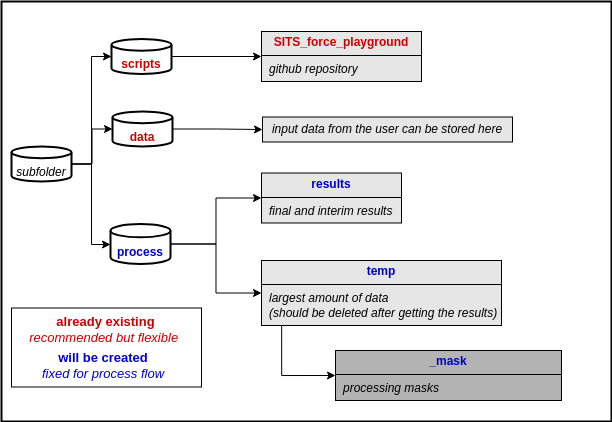

# SITS Force Playground

Code for playing around with [FORCE Time Series Framework](https://force-eo.readthedocs.io/en/latest/index.html). 
The code works with the latest FORCE _**3.9.02-dev:::2025-10-16**_.


## 1. Installing
These basic parameters installations are implemented for Ubuntu. 
To set up the environment, please follow the steps below:
```
conda create --name SITSclass python==3.9
conda activate SITSclass
cd /path/to/your/folder/SITS_force_playground
pip install -r requirements.txt
```

_**Notes:**_ Code is build upon FORCE Framework version 3.9.02. Please make sure to have this version installed. 
You can either install FORCE directly on your system or use the Docker container.

* [How to Install FORCE with Docker](https://force-eo.readthedocs.io/en/latest/setup/docker.html#docker)


## 2. Getting Started

The script is based on the following folder structure:



The script should help to use FORCE-Framework. Use as follows: 
- adjust the parameters in the `config.yaml` file
- run `python pipeline/run.py --config config.yaml`

_**Note:**_ As a thumb rule, always double-check your parameter files before executing them. 
There are many parameters that need to be set according to your data and needs.

### Monthly median NBR UDF

`utils/templates/monthly_median_nbr.py` produces one band per calendar month.
For every quality-screened acquisition it calculates
`NBR = (NIR - SWIR2) / (NIR + SWIR2)`, takes the pixel-wise monthly median,
and stores it as Int16 scaled by 1000.

Use these settings in `config.yaml`:

```yaml
processing:
  mode: UDF

parameters:
  FILE_PYTHON: /path/visible/inside/the/container/SITS_force_playground/utils/templates/monthly_median_nbr.py
  METRIC: MEDIAN
  PYTHON_TYPE: CHUNK
  FILL_INTERNAL_MONTH_GAPS: false
  CHUNK_SIZE: 6000 6000
  NTHREAD_COMPUTE: 1
```

The standalone UDF module receives the complete BOA stack, so `INDEX` does not
limit its inputs. The UDF uses FORCE's `BROADNIR` band (Sentinel-2 B8) and
`SWIR2` (B12). `PYTHON_TYPE: CHUNK` performs vectorized array processing and
avoids invoking Python separately for every pixel.

The final mosaic keeps FORCE's year and day-of-year ranges and is named with
the configured index and metric, for example
`2018-2018_001-365_NBR_MEDIAN.tif`. It is stored in the original AOI-named
subdirectory below `runtime.process_folder/results/job.project_name`, for
example `nbr_germany_2018/germany.shp/2018-2018_001-365_NBR_MEDIAN.tif`.
FORCE's intermediate tile retains its standard
`..._HL_UDF_SEN2L_PYP.tif` name.

The canonical automation entry point is `pipeline/run.py`. It accepts the same
configuration envelope used by the Nextflow orchestrator:

```yaml
job:
  project_name: nbr_germany_2018
runtime:
  process_folder: /drive_mount/process
inputs:
  aois:
    - /drive_mount/general_data/germany/2024_v1_0.shp
```

Repository-relative UDF paths are resolved against the selected Git revision,
so immutable source snapshots do not execute code from an editable checkout.

The configured `DATE_RANGE` determines which months and years are emitted. For
one complete year the output normally contains 12 bands named like
`202501_NBR_MEDIAN`. A month remains nodata at pixels with no valid
observations.

### Fast display in QGIS and nodata swaths

The final mosaic is tiled and contains internal overviews by default. QGIS uses
these lower-resolution pyramid levels when zoomed out instead of decoding the
full 10 m Germany raster. Configure them under `mosaic_output` with
`build_overviews`, `overview_resampling`, and `overview_levels`. `average` is
appropriate for continuous NBR data and ignores the configured nodata value.

Oblique nodata swaths can be real gaps in the monthly source coverage. FORCE
quality-screens every acquisition before calling the UDF; if the available
Sentinel-2 footprints do not overlap a pixel, or every overlapping observation
is rejected by the quality mask, the strict monthly median remains nodata.
Inspect `provenance/*.csv` and the corresponding `*_BOA.tif` and `*_QAI.tif`
files in the lower-level FORCE cube to distinguish source-coverage gaps from
processing failures.

Set `parameters.FILL_INTERNAL_MONTH_GAPS: true` when complete visual coverage
is more important than strict calendar-month semantics. The UDF then linearly
interpolates only missing months that have a valid monthly median both before
and after them in the same year. Leading, trailing, and all-year gaps remain
nodata. The default is `false` because interpolated pixels are estimates rather
than observations from the named month. A wider temporal composite or an
additional sensor is another option when interpolation is not appropriate.

## Versioning
This repository is based on the latest version of FORCE _**3.9.02-dev:::2025-10-16**_.


## Authors

* [**Benjamin Stöckigt**](https://github.com/Bensouh)
* [**Sebastian Valencia**](https://github.com/Azarozo19)


## License

This project is licensed under the GNU General Public Licence, Version 3 (GPLv3) - see the [LICENSE.md](LICENSE.md) file for details 

## Acknowledgments

* Time Series Classification by [Marc Rußwurm](https://github.com/MarcCoru)


* FORCE Framework by [David Frantz] (https://force-eo.readthedocs.io/en/latest/index.html).
